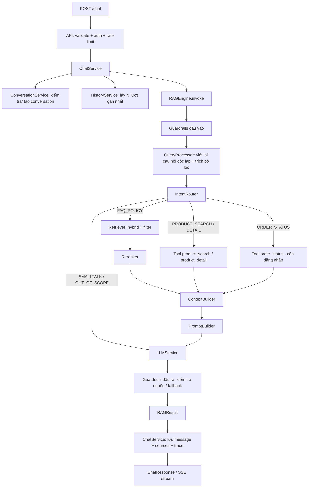

# Kiến trúc hệ thống

## 1. Bối cảnh

```text
ReactJS ──► Spring Cloud Gateway ──► Chatbot Service (FastAPI)
                 (JWT, rate limit)        │
                                          ├──► Qdrant  (tri thức: FAQ, chính sách, mô tả sản phẩm)
                                          ├──► Redis   (cache lịch sử, embedding, rate limit)
                                          ├──► MySQL   (conversation, message, feedback, ingestion registry)
                                          ├──► LLM Provider
                                          ├──► Product Service (live: giá, tồn kho, trạng thái)
                                          └──► Order Service   (live: đơn hàng của chính user)
Product Service ──(Kafka, giai đoạn sau)──► Ingestion
```

## 2. Luồng xử lý một lượt chat



## 3. Phân tầng và quy tắc phụ thuộc

```text
api ─► services ─► rag ─► (embedding, integrations, Qdrant)
 │         │
 │         └─► db (repositories)
 └─► schemas, core

ingestion ─► (embedding, integrations, Qdrant, db.registry)
```

- `api` chỉ nhận request, gọi **`ChatService`** (không gọi trực tiếp ConversationService/RAG/LLM).
- `services` không chứa logic embedding/chunking/truy vấn Qdrant.
- `rag` **không** biết gì về HTTP hay MySQL; nhận input thuần và trả `RAGResult`.
- `embedding` là package duy nhất tạo vector: `rag` (query) và `ingestion` (document) dùng chung
  để đảm bảo cùng model, cùng cách chuẩn hóa.
- `integrations` là nơi duy nhất gọi Product/Order Service (không viết lặp ở services và ingestion).
- `ingestion` không chứa logic retrieval/generation.

## 4. Dữ liệu và nguồn sự thật

| Dữ liệu | Nguồn sự thật | Lưu ở vector? |
|---|---|---|
| FAQ | `data/faq/*.json` | Có (embed câu hỏi + keywords) |
| Chính sách | `data/policies/*.md` (có version, effective_date) | Có (chunk theo heading) |
| Tên/mô tả/danh mục sản phẩm | Product Service | Có (1 sản phẩm = 1 chunk) |
| **Giá, tồn kho, trạng thái** | Product Service (**live**) | **Không** nhúng vào text; chỉ để lọc thô, luôn xác minh live trước khi trả lời |
| Đơn hàng | Order Service (live, theo user) | Không |
| Lịch sử chat, feedback | MySQL | Không |

## 5. Khả năng chịu lỗi (degradation)

| Sự cố | Hành vi |
|---|---|
| LLM timeout / lỗi | Retry (tối đa `LLM_MAX_RETRIES`) → provider dự phòng → thông báo tạm thời không khả dụng |
| Qdrant lỗi | Trả lời bằng thông báo suy giảm; vẫn cho gọi tool sản phẩm nếu Product Service sống |
| Product/Order Service lỗi | Nói rõ "không kiểm tra được lúc này", **không** đoán giá/trạng thái |
| Redis lỗi | Bỏ qua cache, đọc thẳng MySQL; rate limit fail-open có cảnh báo |
| Không tìm thấy thông tin | Thông báo rõ + gợi ý kênh hỗ trợ (handoff), không suy đoán |

## 6. Hiệu năng

- Embedding/rerank là CPU-bound → chạy trong threadpool (`run_in_threadpool`) hoặc tách service sau này.
- MySQL dùng async driver (`asyncmy`).
- Nạp model một lần ở lifespan (mỗi uvicorn worker một bản → lưu ý RAM).
- Cache: embedding của câu hỏi, câu trả lời FAQ lặp lại (key theo hash câu hỏi đã chuẩn hóa + version KB).
- Hỗ trợ SSE streaming (`POST /chat/stream`).

## 7. Quan sát (observability)

- `X-Request-ID` sinh/nhận ở middleware, đi qua mọi log và lưu cùng message.
- Đo thời gian từng bước: `rewrite`, `route`, `embed`, `retrieve`, `rerank`, `llm`, tổng.
- Lưu `RAGTrace` (chunk_id, score, prompt_version, model, token usage) trong bảng `chat_messages.trace`
  để truy ngược khi có feedback tiêu cực.
- Không log API key, token, nội dung PII (xem `docs/SECURITY.md`).
